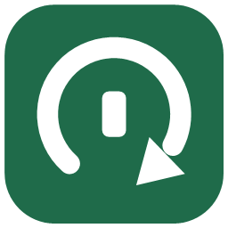

<div align="center">



# SelfRefreshKit

Swift package for on-device provisioning profile refresh and OTA updates on iOS.

[](https://swift.org)
[](https://developer.apple.com/ios/)
[](https://github.com/Cc-Cece/SelfRefreshKit/releases)
[](LICENSE)

<p align="center">
  <b>English</b> | <a href="README_ZH.md">简体中文</a>
</p>

</div>

---

SelfRefreshKit is a SwiftUI library for sideloaded iOS apps. It handles provisioning profile refresh directly on the device and OTA updates from GitHub Releases or direct URLs.

Daily profile refresh runs over a local loopback VPN (`10.7.0.1`), such as [LocalDevVPN](https://apps.apple.com/app/localdevvpn/id6744003051), StosVPN, or WireGuard.

> [!NOTE]
> Requires iOS 17.0+ and Swift 5.9+. Supports iOS 17.4+ RPPairing.

## Features

- **Profile refresh**: Writes `.mobileprovision` directly to `misagent` over loopback. Does not restart the app or require keeping the `.ipa` in the sandbox.
- **Shortcuts automation**: Built-in `AppIntent` (Refresh App Provisioning Profile) to trigger profile renewal via Shortcuts automation.
- **OTA updates**: Downloads unsigned IPAs from GitHub Releases or a direct URL, resigns locally, and installs the update.
- **Status and diagnostics UI**: Provides a SwiftUI page to display remaining profile validity and check pairing files, loopback VPN, Anisette latency, and developer session.
- **Localization**: Built-in strings for English, Simplified Chinese, Traditional Chinese (HK), Japanese, German, French, and Korean.

## Integration

> [!NOTE]
> Reference example: https://github.com/Cc-Cece/PicHarbor-iOS/

### 1. Add package dependency

Add `SelfRefreshKit` to your `Package.swift`:

```swift
dependencies: [
    .package(url: "https://github.com/Cc-Cece/SelfRefreshKit.git", from: "0.3.0")
]
```

### 2. Configure on launch

```swift
import SwiftUI
import SelfRefreshKit

@main
struct MyApp: App {
    init() {
        SelfRefreshManager.shared.configure(
            SelfRefreshConfiguration(
                urlScheme: "myapp",
                preferredVPN: .localDevVPN,
                githubRepository: "yourname/MyApp", // Optional: for GitHub Releases updates
                hostLanguageProvider: { MyAppL10n.currentLanguageCode } // Optional
            )
        )
    }

    var body: some Scene {
        WindowGroup {
            ContentView()
        }
    }
}
```

### 3. Add to settings

```swift
import SwiftUI
import SelfRefreshKit

struct SettingsView: View {
    var body: some View {
        List {
            Section("Signing") {
                SelfRefreshSection()
            }
        }
    }
}
```

## Shortcuts Automation

1. Add the preset [iCloud Shortcut](https://www.icloud.com/shortcuts/14a2c9d0bb974288a2fe45649949a6ca).
2. Or create a personal automation in the Shortcuts app.
3. Action: **Connect LocalDevVPN**.
4. Action: Choose **Refresh App Provisioning Profile** for the host app.
5. Action: Then **Disconnect LocalDevVPN**.

## First-Time Installation

First-time installation and device pairing injection require a computer:

- **[SelfRefreshSetup](tools/SelfRefreshSetup)**: Windows desktop tool to sign, install, and write pairing files or RPPairing records to the app sandbox via USB. Prebuilt binaries can be downloaded directly from [Releases](https://github.com/Cc-Cece/SelfRefreshKit/releases).
